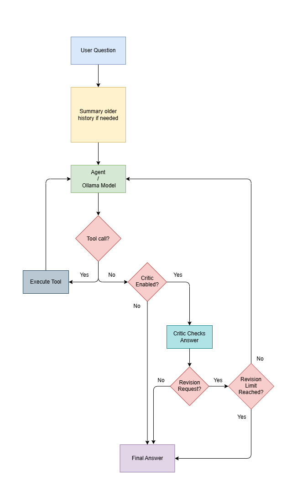
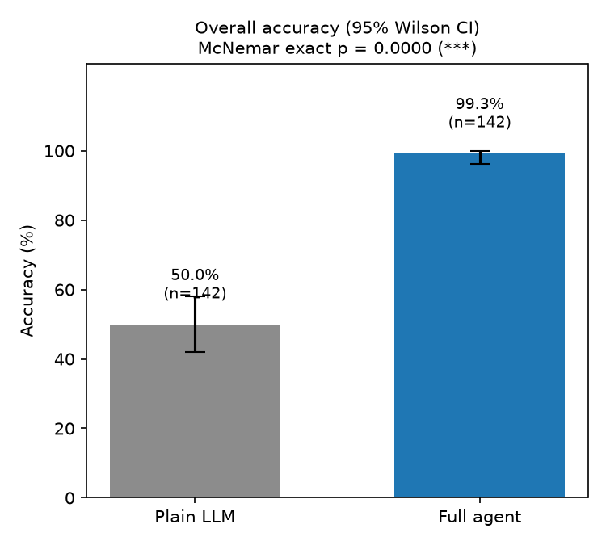
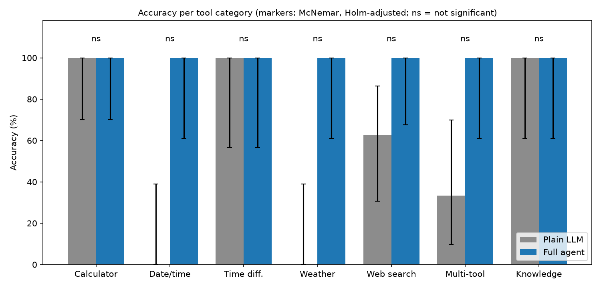
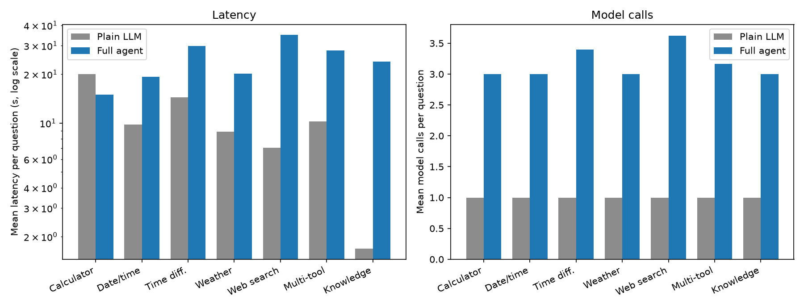
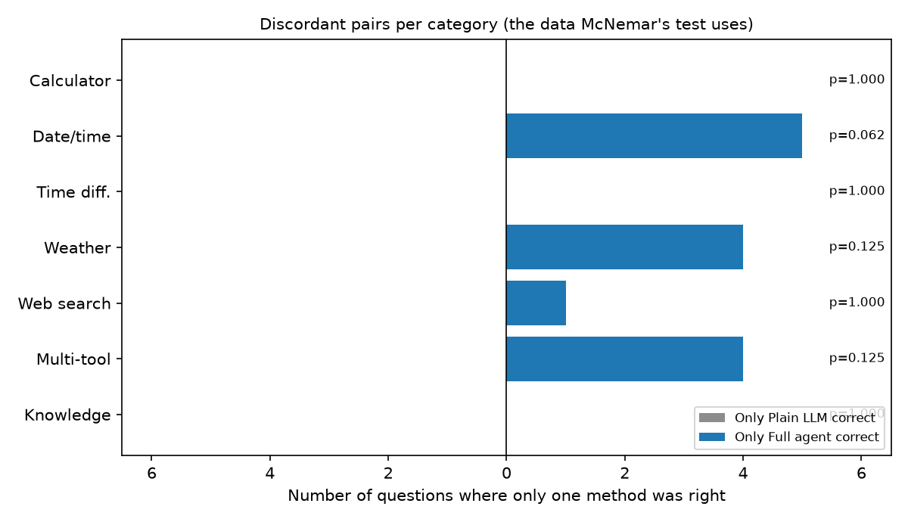

# LangGraph-Agent

A local-first conversational AI agent built with **LangGraph**, **LangChain**, and **Ollama**. It combines tool use, persistent conversations, long-term facts, document retrieval, and an optional self-checking loop in an interactive terminal interface.

The project also includes a benchmark suite for comparing a plain language-model baseline with the full agent across calculation, date/time, weather, web-search, multi-tool, and knowledge questions.

## Features

- **Local language model:** Uses Ollama with `gemma4:e4b` by default.
- **Tool calling:** Provides a calculator, date/time utilities, weather lookup, web search, and document search.
- **Self-checking loop:** An optional critic reviews the agent's answer and can request revisions.
- **Conversation persistence:** Saves sessions and LangGraph checkpoints in SQLite.
- **Long-term facts:** Can extract and reuse durable facts from conversations, with commands to inspect or delete them.
- **Conversation summarization:** Summarizes older messages when the conversation grows, helping keep the model context manageable.
- **Local document RAG:** Indexes supported files in Chroma and retrieves relevant passages for document questions.
- **Internal-step display:** Optionally streams graph-node activity, tool calls, tool results, summaries, and critic verdicts to the terminal.
- **Benchmarking and analysis:** Records model/tool usage, latency, token counts when available, scoring results, paired significance tests, and charts.

## Architecture

The agent is built as a LangGraph workflow:

<div>
    
</div>

The model can call tools when useful. With the critic enabled, a structured verdict determines whether the answer is accepted or sent back to the agent with feedback. The configured revision limit is two. The critic is a best-effort check, not a guarantee that every answer is correct.

Conversation state and checkpoints are persisted in SQLite. Document vectors are stored separately in a persistent Chroma collection. The benchmark uses isolated in-memory graph checkpoints so benchmark runs do not modify the application's conversation checkpoint history.

## Project structure

```text
📁 
├── 📁 benchmark
│   ├── 📁 results
│   │   ├── 📁 figures
│   │   │   ├── 🖼️ 1_overall_accuracy.png
│   │   │   ├── 🖼️ 2_accuracy_by_category.png
│   │   │   ├── 🖼️ 3_cost_latency_calls.png
│   │   │   └── 🖼️ 4_discordant_pairs.png
│   │   ├── 📊 mcnemar.csv
│   │   ├── 📄 raw.jsonl
│   │   ├── 🧩 reviews.json
│   │   ├── 📊 scored.csv
│   │   └── 📊 summary.csv
│   ├── 🐍 __init__.py
│   ├── 🐍 analyze.py
│   ├── 🧩 dataset.json
│   ├── 🐍 extend_dataset.py
│   ├── 🐍 metrics.py
│   ├── 🐍 plots.py
│   ├── 🐍 references.py
│   ├── 🐍 review.py
│   ├── 🐍 run_benchmark.py
│   ├── 🐍 runners.py
│   └── 🐍 smoke.py
├── 📁 src
│   ├── 📁 tools
│   │   ├── 🐍 __init__.py
│   │   ├── 🐍 calculator.py
│   │   ├── 🐍 datetime.py
│   │   ├── 🐍 doc_search.py
│   │   ├── 🐍 weather.py
│   │   └── 🐍 web_search.py
│   ├── 🐍 __init__.py
│   ├── 🐍 baseline.py
│   ├── 🐍 commands.py
│   ├── 🐍 config.py
│   ├── 🐍 display.py
│   ├── 🐍 documents.py
│   ├── 🐍 facts.py
│   ├── 🐍 graph.py
│   ├── 🐍 memory.py
│   ├── 🐍 ollama_server.py
│   ├── 🐍 sessions.py
│   └── 🐍 state.py
├── 📁 tests
├── ⚖️ LICENSE
├── 🐍 main.py
├── 📘 README.md
└── 📝 requirements.txt
```
> Generated using [Tree Printer](https://github.com/AmirmasoudCS/Tree-Printer.git)


## Requirements

- Python with a version compatible with the packages in `requirements.txt`.
- [Ollama](https://ollama.com/) installed and available on your `PATH`.
- The configured chat model and embedding model pulled into Ollama.
- Internet access for tools that query online services, such as weather, geocoding, and web search. The chat model itself runs locally.

The default model settings are defined in `src/config.py`:

| Setting | Default |
|---|---|
| Chat model | `gemma4:e4b` |
| Embedding model | `nomic-embed-text` |
| Ollama endpoint | `http://localhost:11434` |
| Context window | `16384` tokens |
| Maximum critic revisions | `2` |
| Document chunk size | `900` characters |
| Document chunk overlap | `150` characters |
| Retrieved document chunks | `4` |
| Maximum accepted cosine distance | `0.75` |

The embedding model is required for document indexing and search. Pull the models before first use:

```bash
ollama pull gemma4:e4b
ollama pull nomic-embed-text
```

If you change the model names in `src/config.py`, pull those models instead.

## Installation

Run the following commands from the project root.

### 1. Create and activate a virtual environment

**Windows PowerShell**

```powershell
python -m venv .venv
.\.venv\Scripts\Activate.ps1
```

**Linux / macOS**

```bash
python -m venv .venv
source .venv/bin/activate
```

### 2. Install Python dependencies

```bash
python -m pip install --upgrade pip
pip install -r requirements.txt
```

### 3. Download the Ollama models

```bash
ollama pull gemma4:e4b
ollama pull nomic-embed-text
```

### 4. Start the agent

```bash
python main.py
```

At startup, the application checks whether Ollama is responding at `http://localhost:11434`. If not, it attempts to run `ollama serve`. When the application starts Ollama itself, it applies the configured environment settings for flash attention and an 8-bit KV cache. If Ollama was already running, those startup environment settings are not applied to the existing server.

> **Note:** The first model use may take time while Ollama loads the model. The app expects the Ollama executable to be available on `PATH`.

## Using the agent

After startup, enter a question at the `You:` prompt. The agent can answer directly or call a tool depending on the request.

Examples:

- `Calculate (124 * 37) / 8`
- `What time is it in Asia/Tokyo?`
- `What is the time difference between Europe/Berlin and Asia/Tehran?`
- `What is the weather in Berlin?`
- `Search the web for recent developments in trustworthy machine learning.`
- Add a document with `/doc add path/to/document.pdf`, then ask questions about its contents.

Type `quit` or `exit` to leave the chat. Slash commands provide session, document, memory, and feature controls.

### Command-line options

```text
python main.py [options]
```

| Option | Description |
|---|---|
| `--new`, `-n` | Start a new session |
| `--session ID_OR_NAME`, `-s ID_OR_NAME` | Resume a session by ID or name |
| `--list`, `-l` | Choose a saved session interactively |
| `--remove-session ID_OR_NAME`, `-rm ID_OR_NAME` | Delete a session |
| `--memory`, `-m` | List saved long-term facts |
| `--forget ID_OR_ALL`, `-f ID_OR_ALL` | Delete a fact by ID or delete all facts with `all` |
| `--internal-messages-on`, `-imon` | Display graph-node activity and tool details |
| `--internal-messages-off`, `-imoff` | Display only the final answer |
| `--no-critic`, `-nc` | Disable the self-checking critic |
| `--no-facts`, `-nf` | Disable reading and extracting long-term facts |

Examples:

```bash
python main.py --new
python main.py --session "my-session"
python main.py --list
python main.py --no-critic
python main.py --no-facts
python main.py --internal-messages-on
```

By default, the app resumes the most recently used session if one exists; otherwise, it creates a new session. A new session is named after the first question.

### In-chat commands

Enter `/help` inside the chat to see the registered commands. The command set includes:

| Command | Purpose |
|---|---|
| `/help` | Show command help |
| `/status` | Show current session and feature status |
| `/imon` / `/imoff` | Toggle internal-step display |
| `/critic on` / `/critic off` | Toggle the critic |
| `/facts on` / `/facts off` | Toggle long-term fact use and extraction |
| `/memory` or `/mem` | List saved facts |
| `/forget <id\|all>` | Delete one or all saved facts |
| `/sessions` or `/ls` | List saved sessions |
| `/new` | Start a new session |
| `/open <number\|id\|name>` | Switch to a saved session |
| `/doc add <path>` | Index a document |
| `/doc list` | List indexed documents |
| `/doc remove <id>` | Remove an indexed document |
| `/quit`, `/exit`, or `/q` | Exit the application |

The exact aliases and syntax are available through `/help`.

## Tools

| Tool | Purpose |
|---|---|
| `calculator` | Evaluates arithmetic expressions using a restricted AST-based evaluator rather than Python `eval`. |
| `get_current_datetime` | Returns the current local time, an IANA time-zone time, or a city time resolved through geocoding. |
| `time_difference` | Compares the current local times and UTC offsets of two locations/time zones. |
| `get_weather` | Retrieves current weather and a short, hourly forecast from Open-Meteo. |
| `web_search` | Returns up to four DuckDuckGo text-search results. |
| `search_documents` | Retrieves relevant passages from documents indexed by the application. |

Weather, geocoding, and web-search tools require network access. Tool results may be unavailable if an external service fails or rate-limits requests.

## Document search (RAG)

The document subsystem extracts text from supported files, splits it into overlapping chunks, embeds the chunks with Ollama, and stores vectors in Chroma. Search results are filtered by cosine distance and returned to the agent as passages with source metadata.

Supported extensions:

- Text and markup: `.txt`, `.md`, `.markdown`, `.rst`, `.log`
- Structured/text data: `.csv`, `.json`
- Source code: `.py`
- Documents: `.pdf`, `.docx`

PDF text is extracted with `pypdf`. DOCX paragraphs and tables are flattened into text; table rows are joined with separators. Scanned PDFs without an extractable text layer are not OCR-processed by this pipeline.

Add, list, or remove documents from the chat:

```text
/doc add path/to/document.pdf
/doc list
/doc remove <document-id>
```

The default persistent Chroma directory is `data/chroma`. Document metadata is stored in the SQLite database at `data/agent.db`. Re-adding a file with the same content is detected using a SHA-256 hash.

## Persistence and memory

The project uses SQLite for conversation checkpoints, sessions, and long-term facts. The default database is `data/agent.db`. Chroma stores document embeddings in `data/chroma`.

The agent also manages the conversation context:

- Older messages can be condensed into a rolling summary when token thresholds are reached.
- Recent messages are retained, and the history sent to the model is trimmed to a configured token budget.
- Long-term facts are extracted after an answer when the feature is enabled.
- The critic can request a limited number of answer revisions.

These features are configurable in `src/config.py` and through the CLI or in-chat commands described above. Long-term facts are distinct from the message history and document index.

## Benchmark

The benchmark compares a plain LLM baseline against agent configurations on a fixed question dataset. Run commands from the project root.

### Conditions

| Condition | Description |
|---|---|
| `baseline` | One plain call to the configured local LLM, without tools, conversation memory, or critic. |
| `agent_no_critic` | Agent with tools and conversation summarization, with the critic disabled. |
| `agent_full` | Agent with tools, summarization, and the self-checking critic enabled. |

The runner supports all three conditions. The analysis script currently reports the main comparison between `baseline` and `agent_full`.

Long-term facts are disabled for benchmark agent runs. Each question receives a fresh thread with an in-memory checkpointer, so the benchmark does not reuse the application's persistent conversation checkpoints. The runner fetches a live reference immediately before running the conditions for a question, allowing the compared conditions to use the same reference.

### Run the benchmark

Run the full default comparison:

```bash
python -m benchmark.run_benchmark
```

Run a small test:

```bash
python -m benchmark.run_benchmark --limit 5
```

Select categories or specific question IDs:

```bash
python -m benchmark.run_benchmark --categories weather calculator
python -m benchmark.run_benchmark --ids calc-01 wx-02
```

Select experimental conditions or start a fresh raw-results file:

```bash
python -m benchmark.run_benchmark --conditions baseline agent_no_critic agent_full
python -m benchmark.run_benchmark --fresh
```

The runner records results in `benchmark/results/raw.jsonl` and can resume by skipping question/condition pairs already recorded. `--fresh` removes the existing raw JSONL before running; preserve or back up that file first if you need its contents.

### Score and analyze results

```bash
python -m benchmark.analyze
```

To regenerate the analysis without generating charts:

```bash
python -m benchmark.analyze --no-plots
```

The analysis produces:

- `benchmark/results/scored.csv` - scored run-level results.
- `benchmark/results/summary.csv` - overall and per-category summary metrics.
- `benchmark/results/mcnemar.csv` - paired significance-test results.
- `benchmark/results/figures/` - benchmark charts.

Automatic checks may return **undecided** when an answer cannot be reliably assessed. Accuracy and confidence intervals are calculated over decided cases; undecided counts are reported separately. Human judgments can be used for these cases.

### Review undecided answers

```bash
python -m benchmark.review
```

For each undecided result, the reviewer shows the question, model answer, automatic-check note, and available live search snippets. Use:

- `y` - correct
- `n` - incorrect
- `s` - skip
- `q` - save and quit

Labels are saved to `benchmark/results/reviews.json` and are consumed by the analysis script on the next analysis run.

### Metrics and statistical analysis

The benchmark reports accuracy, 95% Wilson confidence intervals, decided and undecided counts, latency, LLM calls, tool calls, token counts when available, revisions, and errors. It also reports paired outcomes and McNemar tests, with Holm–Bonferroni correction across categories.

The benchmark includes automatic checks for numeric answers, keyword/containment matches, time values, weather values, time-zone differences, search evidence, and composite checks. Some checks intentionally remain undecided rather than guessing when the evidence is insufficient.

## Benchmark results

The following figures are generated by `python -m benchmark.analyze`. Replace each placeholder with the corresponding image path if you want to publish charts from a different location. The default paths below match the project structure.

### 1. Overall accuracy

<!-- BENCHMARK CHART PLACEHOLDER: overall accuracy -->
<div align="center">
  
</div>

### 2. Accuracy by category

<!-- BENCHMARK CHART PLACEHOLDER: accuracy by category -->
<div align="center">
  
</div>

### 3. Latency and model calls

<!-- BENCHMARK CHART PLACEHOLDER: latency and model calls -->
<div align="center">
  
</div>

### 4. Discordant pairs

<!-- BENCHMARK CHART PLACEHOLDER: discordant pairs -->
<div align="center">
  
</div>

> These figures are generated outputs, not fixed results: rerunning the benchmark or analysis may change them. Interpret accuracy together with the decided/undecided counts, confidence intervals, and paired significance tests.

## Configuration

Edit `src/config.py` to change the chat model, context size, critic revision limit, embedding model, document chunking, retrieval count, and similarity-distance threshold.

The agent expects Ollama at `http://localhost:11434`. The startup helper applies `OLLAMA_FLASH_ATTENTION=1` and `OLLAMA_KV_CACHE_TYPE=q8_0` only if it starts the Ollama server itself. If Ollama is already running, restart it before launching the application if you want those environment settings applied.

## Troubleshooting

- **`ollama` is not found:** Install Ollama and make sure its executable is on your `PATH`.
- **The server does not start:** Check that Ollama is installed and that port `11434` is available.
- **The chat model is missing:** Run `ollama pull gemma4:e4b`, or pull the model configured in `src/config.py`.
- **Document indexing fails:** Confirm that `nomic-embed-text` (or the configured embedding model) is available in Ollama.
- **No document passages are returned:** Confirm the document was indexed successfully and that its content is extractable text. Scanned PDFs require OCR before this pipeline can search their contents.
- **Weather or web search fails:** Check network access; the external APIs and search service may fail or apply rate limits.
- **Ollama settings seem unchanged:** The helper does not reconfigure a server that was already running. Stop the existing Ollama process and restart the application.

## License

See [LICENSE](LICENSE).
